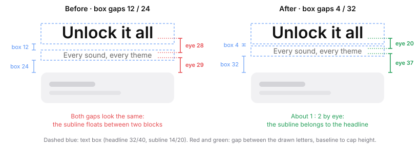

# Design Stuff Kit

A Claude Code plugin for product designers. Describe the task in plain words and Claude follows a tested design workflow: explore options fast, build in Figma from your design system, fix prototype motion, review copy, and ship a shareable prototype.

Claude always asks before editing a Figma file and saves a restore point first.

## What's new in 0.2

### Spacing that follows the grouping

`figma-design-system-ui` sets vertical spacing from the structure of the screen, not by feel:

- **One gap size per level:** inside a cluster (L1, about 4–8), between clusters (L2, about 12–16), between sections (L3, about 24–32), and to the screen edge (16 or more), always from the system's tokens.
- **Each outer level is about 1.5–2× the one inside it.** When two levels come out nearly equal, the groups blur together.
- **A script lists every visible gap** from top to bottom and labels it, so a broken rhythm shows up as numbers instead of a hunch.

### Measure the letters, not the text box

A text box adds half-leading above and below the letters. A headline with a tall line height therefore looks farther from the next line than its gap value says. The kit now measures spacing and alignment on the **drawn letters**, using Figma's `absoluteRenderBounds`, which returns the outline of the actual glyphs.

From a real project: a paywall headline (32/40) sat over a one-line subline (14/20), with plan cards below. With box gaps of 12 and 24, the two gaps looked the same, and the subline seemed to float between the headline and the plans. Box gaps of 4 and 32 gave about 1 : 2 by eye, and the subline joined the headline.



The same rule covers **optical alignment**, for the cases where correct numbers still look wrong:

- Icons and button labels centered on the cap height, not the text box (Figma's leading trim).
- A play triangle moved toward its point.
- Round shapes drawn a little larger than square ones.
- Large headlines pulled out to the margin.
- Less padding on the icon side of a button.
- Nested corner radii.

Each correction is limited to 2 px at UI sizes, never made inside a library component, and written down so a developer does not "fix" it back.

### The 12 principles of animation

The new `motion-principles` skill applies Disney's 12 principles to product UI and calibrates them for interfaces, not cartoons. For each principle it gives how far to push it on a calm product, and it ends with a review checklist. When you describe a feeling, it starts from the matching principles before changing any numbers:

| You say | It checks |
|---|---|
| "Stiff, robotic" | Slow in and slow out, overlap |
| "Floaty, slow" | Timing, follow through |
| "Cheap, tacky" | Exaggeration, secondary action, squash |

### Ask in Vietnamese

Every skill and agent also loads from a request written in Vietnamese ("vẽ wireframe", "chấm điểm thiết kế", "chuyển động bị cứng"), and Claude replies in the language you write in. Details for each release are in the [Changelog](CHANGELOG.md).

## Install

Pick the way that matches where you use Claude Code. Both end with `install-yummy` (adds five Yummy Labs skills, needs Python 3.10+) and `start-design` (see [First time](#first-time)).

### Claude Code in a terminal (CLI)

In your project folder, start `claude` and type these one at a time:

```text
/plugin marketplace add namvunhatle/design-stuff-kit
/plugin install design-stuff-kit@design-stuff-kit
/reload-plugins
/design-stuff-kit:install-yummy
/design-stuff-kit:start-design
```

Then turn on auto-update: `/plugin` → **Marketplaces** → `design-stuff-kit` → **Enable auto-update**.

### Claude Code in VS Code (extension)

In the chat panel, `/plugin` only opens the **Manage plugins** dialog and ignores arguments, so install from the dialog:

1. Paste this link into your browser and open it, then pick a scope (**Project** to share with teammates):

   ```text
   vscode://anthropic.claude-code/install-plugin?plugin=design-stuff-kit&marketplace=namvunhatle/design-stuff-kit
   ```

   Or type `/plugins`, add `namvunhatle/design-stuff-kit` in **Marketplaces**, and click **Install** in **Plugins**.
2. If the dialog says **Restart Claude to apply plugin changes**, restart the session.
3. In the chat, run `/design-stuff-kit:install-yummy`, then `/design-stuff-kit:start-design`.

The extension shares plugin settings with the CLI. To turn on auto-update, run `claude` once in VS Code's terminal and use the CLI step above.

### Other ways

- **Team project:** run once in a terminal inside the project, then commit `.claude/settings.json`:

  ```sh
  claude plugin marketplace add namvunhatle/design-stuff-kit --scope project
  claude plugin install design-stuff-kit@design-stuff-kit --scope project
  ```

- **One script for everything, including Figma:** clone this repo and run `./start --project /path/to/your-project`. Needs Git and Python 3.10+.

### Needed for some work

| For | You need |
|---|---|
| Anything in Figma | Figma Desktop and the Figma Console connector ([setup](docs/FIGMA_SETUP.md), ~5 min) |
| Web exploration and rendering | Node.js 18+ |
| Real-app references | Mobbin connector, optional ([setup](docs/FIGMA_SETUP.md#5-optional-mobbin)) |

## Use it

### First time

Run `/design-stuff-kit:start-design`. It:

1. Reads your project. If context is thin, it offers to install Yummy Labs' `design-context-setup` for a short interview.
2. Suggests a few working rules. You pick which to turn on.
3. Asks for one task, shows the plan, and does the first step.

### After that

Open Claude Code in your project and say what you need. The right skill loads on its own:

> "Compare three layouts for the saved-items screen. Keep them rough."
>
> "Review the copy on the onboarding screens in Figma file ABC. Don't edit the file."

| You want to… | Skill |
|---|---|
| Compare directions, then finalize the pick | `explore-vs-final` |
| Explore as HTML phone screens, then rebuild in Figma | `web-explore` → `ship-to-figma` |
| Build wireframes or production UI in Figma | `figma-wireframe-kit`, `figma-design-system-ui` |
| Move a feature to another Figma file | `figma-clone-port` |
| Fix Smart Animate motion, or build it in Rive | `figma-prototype-motion`, `rive-motion` |
| Plan or critique motion with the 12 animation principles | `motion-principles` |
| Get a scored critique of rendered screens | `design-critique` |
| Set a product voice | `voice-tone-builder` |
| Ship a prototype link, or an Android demo | `prototype-vercel-deploy`, `web-android-port` |

Run `start-design` again after a kit update. Full tracks: [Workflows](WORKFLOWS.md). Every skill, rule, and agent is listed in the [Reference](docs/REFERENCE.md).

## Updating the kit

With auto-update on, the kit updates when Claude Code starts. Otherwise run `/plugin marketplace update design-stuff-kit`, then `/reload-plugins`.

Files in your project (`.claude/rules/`, `critique/config.md`, `design.md`, settings) never change on update. Run `/design-stuff-kit:start-design` after an update to see what needs a hand edit.

Something failed? See [Troubleshooting](docs/TROUBLESHOOTING.md).

## License

Original content is [MIT](LICENSE). `content-research-writer` by ComposioHQ keeps its [Apache 2.0](skills/content-research-writer/LICENSE-2.0.txt) license. The Yummy Labs skills are distributed by their author and are not covered here; see [Third-party](THIRD_PARTY.md). Contributions: [CONTRIBUTING.md](CONTRIBUTING.md).
